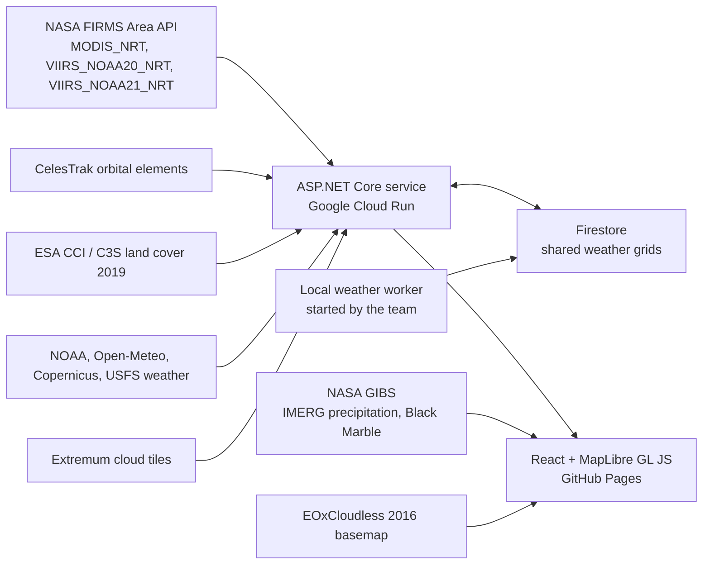

# Earth Fire Calendar: technical note

[Slides](../presentation/demo-slides.md) · [Video script](../video/demo-video.md) · [Project page text](project-description.md) · [Technical note](technical-note.md) · [Form fields](../working/form-fields.md) · [Formal requirements](../docs/formal-requirements.md) · [Advice](../docs/advice.md)

**Challenge:** Harmonization of MODIS and VIIRS Hot Spots · **Team:** Plush — Alexey Belkin, Viktoriia Naiman · **Version described:** commit `c16b7b7`, 15 November 2026 · **App:** [avbelkin.github.io/nasa-space-apps-sg](https://avbelkin.github.io/nasa-space-apps-sg/#z=3&lat=1.3521&lng=103.8198&sensor=modis&proj=globe&orbits=0&clouds=0&lights=0&rain=0) · **Code:** [github.com/avbelkin/nasa-space-apps-sg](https://github.com/avbelkin/nasa-space-apps-sg)

This note answers the questions the demo and the project page leave open: what exactly is computed, from which data, how it was checked, and what is still a plan. Status: prototype documentation; reproduction and rights limitations are explicit below.

## 1. Summary and status

Earth Fire Calendar is a web app that compares MODIS and VIIRS active-fire detections from the last 24 hours of NASA FIRMS data and attaches to each detection the conditions under which it was observed. It is a tool for studying the difference between the sensors: it makes the gap visible and collects the per-detection evidence needed to model it. First baselines fitted on one day of this evidence are already used in the app: notes on predicted passes that reported nothing, a flag for a pass that was expected to detect the fire and did not, and an experimental estimate of the fire radiative power (FRP) the next pass would report. Where Copernicus GWIS fire-weather or CAMS aerosol fields are available, a weather-assisted variant of the detection model is applied; for MODIS → MODIS the GWIS variant also supplies the FRP estimate.

| Part | Status |
|---|---|
| Live 24-hour FIRMS detections, sensor filter, counters | Working, live data |
| Colouring of detection groups by sensor | Working, live data |
| Pinned 24-hour timeline with satellite passes | Working; passes are an orbital estimate |
| Viewing-geometry enrichment | Working; an estimate from public orbital elements |
| Land-cover enrichment | Working; fixed 2019 map |
| Weather at acquisition | Working: every field for pinned detections, gridded fields in the background for the most recent detections; coverage depends on the source |
| Shared cache of weather source grids | Working; filled by the service and, for the whole feed, by a worker the team starts by hand |
| Enrichment progress in the side panel | Working |
| Notes on unmatched passes for a single pinned detection, same sensor family and the other family | Working; passes are an orbital estimate, the context comes from a one-day baseline, no per-detection probability |
| **Expected detection, no match** flag for a VIIRS detection and the other VIIRS satellite | Working, experimental; a calibrated logistic model fitted on one 24-hour snapshot gives the detection score, [section 6](#6-first-baselines-on-matched-passes) |
| Estimated FRP on the next pass, if it detects the fire | Working, experimental; coefficients fitted on one 24-hour snapshot, [section 6](#6-first-baselines-on-matched-passes) |
| Weather-assisted predictions | Experimental. GWIS contributes detection odds and conditional FRP for MODIS → MODIS. CAMS contributes detection odds for VIIRS → VIIRS. |
| FIRMS archive since 2000 | Not built |
| Harmonized record, calibration, validation | Not built; design in [section 7](#7-from-enrichment-to-harmonization) |
| Area and date selection, export | Not built |

The app shows live FIRMS detections alongside three types of model output. It labels the FRP estimate alongside the original FIRMS reading, shows the calibrated detection score in the **Expected detection, no match** flag, and shows how GWIS or CAMS changes the study model's detection odds. Each is labelled next to the value as experimental Earth Fire Calendar model output that NASA has not validated.

## 2. The problem in the data

One snapshot of the app's feed, fetched on 15 November 2026 at 08:36:16 UTC, window 14 November 08:36 – 15 November 08:36 UTC, whole world. The summary is saved in [`firms-snapshot-2026-11-15T0836Z.json`](../working/firms-snapshot-2026-11-15T0836Z.json).

| | MODIS (Terra + Aqua) | VIIRS (NOAA-20 + NOAA-21) |
|---|---|---|
| Detections in 24 hours | 8,127 | 79,349 |
| By satellite | Terra 2,614 · Aqua 5,513 | NOAA-20 41,306 · NOAA-21 38,043 |
| Day / night | 5,893 / 2,234 | 58,198 / 21,151 |
| Median FRP per detection | 14.5 MW | 5.6 MW |

VIIRS reported 9.8 times more detections than MODIS, and its typical detection was weaker. Smaller pixels and different sensitivity are important contributors: a 375 m pixel can resolve smaller fires, and one MODIS pixel can cover several VIIRS detections. This one-day comparison also mixes observation timing, coverage and processing effects; it does not isolate the contribution of pixel size. These are counts of hot pixels per satellite pass, not of fires; the ratio is for this day only and varies by region, season and time of day (see the [literature review](modis-viirs-harmonization-literature-review.md), §1–§3).

## 3. System overview



- **Interface** (`ui/`): TypeScript, React 19, Vite, MapLibre GL JS with custom WebGL2 layers. A static site, rebuilt by GitHub Actions on every push to `main` that touches `ui/`.
- **Service** (`backend/`): C#, .NET 10, ASP.NET Core minimal API in a container on Google Cloud Run (`asia-southeast1`). It holds the FIRMS key, caches upstream data in memory and does all enrichment. The only stored data is a Firestore cache of weather source grids, shared between service instances; every cache can be rebuilt from public sources.
- **Model coefficients** are fitted offline and evaluated in the browser. The FRP baseline, the calibrated VIIRS warning model, and the weather-assisted models are stored in `ui/src/data/`. The weather-assisted models reuse the weather already fetched for the pinned detection.
- The view state (position, sensor, layers) lives in the URL hash, so any view can be shared as a link.

## 4. Detections: ingestion and display

**Ingestion.** The service queries the FIRMS Area API (`api/area/csv`) for `MODIS_NRT`, `VIIRS_NOAA20_NRT` and `VIIRS_NOAA21_NRT`, parses the CSV, and keeps position, acquisition time, satellite, FRP, brightness temperature, confidence, `scan` and `track` pixel size and the day/night flag. A snapshot is cached for 20 minutes and cut to a rolling 24 hours ending now, not to UTC calendar days. If a refresh fails, the previous snapshot is served and marked as a cached fallback.

**Confidence.** MODIS reports confidence as 0–100; VIIRS reports `low`, `nominal` or `high`. For display only, the VIIRS classes are mapped to 25, 65 and 95. These are not probabilities and are not comparable between the sensors.

**Display.** Dot size follows FRP, brightness follows confidence, pulse strength follows the age of the detection. Below the full-detail zoom, nearby detections are merged into one mark; selecting a mark expands it to all detections it stands for.

**Sensor comparison.** The **All sensors / MODIS / VIIRS** control filters the detections, counters and satellite tracks. In **All sensors** the detections are shown together with no calibration and no removal of duplicates; the internal name of this mode is `harmonized`, but it is not a harmonized product. With **Color fire spots by sensor**, detections that are drawn close together on screen form a group, and the group is coloured by its content:

| Colour key | Rule |
|---|---|
| Both sensors | The group has at least one MODIS and one VIIRS detection |
| MODIS only (2+) | Two or more detections, all MODIS |
| VIIRS only (2+) | Two or more detections, all VIIRS |
| Single detection | One detection |

The grouping is by screen distance, so it changes with zoom. It is a visual aid for finding agreement and disagreement, not a footprint-and-time match between passes.

**Pinned timeline.** Selecting a detection or a group pins a 24 × 1 h chart: FRP bars by satellite, the local Sun elevation curve, and two kinds of marks computed from orbits rather than taken from FIRMS:

- **Pass, no fire** — the satellite's swath covered the place in that hour and FIRMS has no detection there. The cause can be no fire, cloud, a fire below the detection limit, or a gap in the data; the app cannot tell which.
- **Processing** — passes within a fixed delay before now (90 minutes for VIIRS, 120 minutes for MODIS) whose detections may not have been published yet. The delays are our assumptions, not FIRMS status.

**Notes on unmatched passes.** When one detection is pinned, the app looks for a later predicted pass by another satellite, within six hours of the detection, that has no matching detection. A pass counts only when it is settled: the ±25-minute match window and the expected publication delay have both passed.

- **Same sensor family** (for example Terra after Aqua): the pass has no detection in the current selection. The note appears only when a baseline association applies, and names it: the land-cover class or the first detection's FRP band, and the distance to the second ground track.
- **Other sensor family** (MODIS after VIIRS, or the reverse): the whole live feed, including detections hidden by the sensor filter, has no detection from that spacecraft within 1 km and ±25 minutes of the pass. The note names the spacecraft and the distance from the predicted ground track to the detection.

The notes say whether the baseline saw fewer or more misses under these conditions. They give no probability for the individual detection, and a missing match can come from an error in the predicted coverage, late data, cloud, a change in the fire, or sensor sensitivity.

**Expected detection, no match.** For a pinned NOAA-20 or NOAA-21 detection the app also scores the other VIIRS satellite's settled pass with the VIIRS → VIIRS model of [section 6](#6-first-baselines-on-matched-passes). If the calibrated detection score is 70% or more and the whole live feed has no detection from that spacecraft within 1 km and ±25 minutes of the pass, the card shows this flag in an error colour, with the spacecraft, the pass time and the score, in place of the same-family note. The score comes from one day of data and is not a validated probability; the flag marks a case worth a closer look, not a confirmed omission.

**Predicted FRP if detected.** For one pinned detection the app finds the next predicted pass by a different spacecraft that is still in the future and within six hours of the detection, and shows the FRP that pass would report if it detects the fire, with the signed change in MW. The original FIRMS value stays visible under the estimate and in the timeline. For a MODIS detection and the other MODIS satellite, when Copernicus GWIS fields for the acquisition day are available, the value comes from the GWIS-assisted model and the heading reads **GWIS-adjusted FRP if detected**. The models are described in [section 6](#6-first-baselines-on-matched-passes).

**Weather context.** For one pinned detection and a pass by the other satellite of the same sensor family the card shows one more line: `GWIS context` for MODIS → MODIS or `CAMS context` for VIIRS → VIIRS, with the satellite, the pass time and a multiplier of the study baseline's detection odds. The pass is the one used for the FRP estimate, the one behind the flag above, or an unmatched settled pass. The line appears only when at least one GWIS field is valid on the acquisition day, or the validity window of one CAMS field reaches the hour before acquisition; a field without a value is passed to the model as missing. MODIS → VIIRS and VIIRS → MODIS have no weather line. The multiplier does not change the 70% threshold of the flag.

**Attribution of model output.** The FRP estimate, the flag and the weather line each carry a note that they are experimental Earth Fire Calendar model output, and that NASA has not validated it and is not responsible for its accuracy.

## 5. Per-detection enrichment

Each enrichment is optional and deferred: the detections are served first, and a missing value stays `null` with no substitute. The side panel reports the progress of each stage: detections loaded, geometry ready and pending, land cover, and weather checked and pending.

### 5.1 Viewing geometry

FIRMS near-real-time records do not carry the view angle. The service estimates it:

1. Take the satellite's orbital elements from CelesTrak (cached for 12 hours; embedded fallback sets if CelesTrak is unreachable).
2. Propagate the orbit with a J2 secular model and sample it every 15 seconds from 1 minute before to 7 minutes after the FIRMS acquisition time, which has minute precision.
3. Take the closest approach across the track as the moment of observation and report the slant range, the off-nadir angle at the spacecraft and the view zenith and azimuth at the hotspot.
4. For that moment compute Sun and Moon elevation and azimuth, the Moon's illuminated fraction, and the glint angle: the angle between the mirror reflection of the light source and the direction to the satellite, as defined in the MODIS Collection 6 and VIIRS 375 m fire algorithms.

The orbit result is dropped if the elements are more than five days from the acquisition or the match to the swath is implausible. The estimate ignores terrain, refraction and the instruments' own per-pixel geolocation. The interface shows off-nadir angle, distance, Sun and Moon elevation and glint, and Moon illumination, in separate MODIS and VIIRS columns.

### 5.2 Land cover

The service samples the Copernicus C3S land cover map v2.1.1 for 2019, the continuation of the ESA CCI Land Cover series: 300 m native grid, 1.2 km overview for whole-world requests, the same class codes in both. The footprint of a detection is approximated by a circle with the same area as its `scan` × `track` pixel; if those fields are missing, by the nominal pixel radius. The result is the dominant class, the share of each class in the footprint and the fraction of the footprint with classified data.

The map is a fixed 2019 reference, not the cover on the day of the fire. On the 1.2 km overview a whole VIIRS footprint can fall into one cell.

### 5.3 Weather at acquisition

For pinned detections (up to 16 per request) the service samples each source at the detection's acquisition time and returns, for every value, the source, model run, valid time or interval, unit and sampled grid point. For NOAA GFS a model run is used only if its file was published before the acquisition; the other forecast sources report validity but not publication time.

A background pass samples the gridded sources (NOAA GFS, Copernicus GWIS, NOAA CPC, WFAS) without waiting for a selection. It covers the 512 most recent unique locations and acquisition times in the 24-hour window, up to 64 per feed refresh; older detections get weather only when pinned. Pinned requests reuse these samples and fetch the remaining fields. Sampled values stay in the memory of the service instance until the detection leaves the 24-hour window.

What the instances share is the source data, not the samples. The encoded grids (GRIB2, PNG, GeoTIFF), as downloaded or as cut from a larger file by the worker described below, are stored in Firestore under a key of product, model run or date, forecast hour and tile, so any instance can sample a grid that another one fetched. GFS grids expire 25 hours after their valid hour; the daily and weekly rasters are refreshed at short intervals and keep the upstream modification time. If the shared cache is unavailable, the service downloads the grid from the source.

To fill the cache for the whole feed and not only for the 512 targets, the team can start a local worker (`scripts/start-local-weather-worker.ps1`): the same service code in a mode that preloads unexpired Firestore grid IDs, scans the worldwide 24-hour feed every two minutes, fetches `.idx` byte ranges from NOAA's public GFS mirrors on Google Cloud Storage (with AWS S3 fallback) to slice and batch-write missing 4° simple-packed GRIB2 tiles without NOMADS CGI throttling, and refreshes the daily and weekly rasters concurrently. It runs only while a team member keeps it running. The side panel shows the number of shared grids; on 15 November 2026 it was 3,121 at 11:12 UTC and 12,582 at 12:10 UTC.

| Source | Fields | Coverage and time matching |
|---|---|---|
| NOAA GFS | Temperature, dew point, humidity, visibility, wind and gusts, irradiance, cloud cover and layers, column water, precipitation type, snow depth and cover, soil water by depth, cloud liquid and ice water at pressure levels | Global; run and valid hour chosen explicitly; bilinear sampling, nearest cell for flags |
| NOAA GOES-R ABI and GLM | 10.3 µm brightness temperature, cloud class, cloud fraction over the footprint, optical depth, cloud-top height and phase, smoke flag, lightning flashes within 50 km | GOES East and West coverage; completed scans matched to acquisition, scan times kept |
| NOAA nowCOAST | Radar reflectivity; visible and infrared counts from the global satellite mosaic | Radar regional, within 8 minutes; mosaic hourly, within 1 hour |
| Open-Meteo | Weather codes, 3- and 24-hour precipitation totals; from Copernicus CAMS Global: aerosol optical depth, dust, particulates, CO | Global, hourly; totals need every hour of the window |
| Copernicus GWIS | Fire Weather Index, danger class, Fine Fuel Moisture Code, Drought Code, modelled lightning density | Global, daily; date-level precision |
| Copernicus GDO | Soil-moisture anomaly against 1995–2023 and its class | 10-day periods; the latest period completed at acquisition |
| NOAA CPC | Weekly soil-moisture departures at 0–10, 10–40, 40–100 cm | North America; the latest completed week |
| US Forest Service WFAS | 10-, 100- and 1,000-hour dead-fuel moisture | Contiguous United States; daily, no verified hour |

The interface shows 23 of these fields in the **Weather at acquisition** table and hides the rows that no source could fill. Model values are not observations, and daily and weekly products describe the period, not the minute of the pass. Which fields are worth testing first, and why, is in [`doc/live-hotspot-weather-enrichment.md`](../../doc/live-hotspot-weather-enrichment.md).

## 6. First baselines on matched passes

The original baselines use detection attributes, estimated geometry and land cover from one snapshot of the app's feed, 14 November 2026 at 10:10 UTC through 15 November at 10:10 UTC. All comparisons use five folds of held-out 5° geographic blocks. The weather follow-up below compares versions with and without weather on the same selected cases. The fitting scripts and full frozen training input are not distributed in this repository. Published coefficients support inference, but the reported training and evaluation cannot yet be reproduced independently from this submission.

**Will the next pass miss?** The target is an inferred miss: a later predicted pass, within six hours, by another satellite with no FIRMS detection within ±25 minutes and within 1 km of a MODIS anchor or 500 m of a VIIRS anchor (1 km in the cross-family case). Passes still inside the match window or the expected publication delay are excluded. One regularized logistic regression per row:

| Anchor → later pass | Eligible passes | Miss rate | AUROC | Strongest feature group (AUROC lost without it) |
|---|---:|---:|---:|---|
| MODIS → MODIS | 4,458 | 92.1% | 0.752 | Land cover (0.034) |
| VIIRS → VIIRS | 31,515 | 63.0% | 0.756 | First detection's FRP and brightness (0.025) |
| MODIS → VIIRS | 3,634 | 57.5% | 0.643 | Viewing geometry of the later pass (0.062) |
| VIIRS → MODIS | 30,761 | 92.5% | 0.768 | Viewing geometry of the later pass (0.101) |

Examples of the associations the app quotes: after a VIIRS detection of 2–5 MW the other VIIRS satellite missed 70.1% of the time, after 20–50 MW 49.3%; a MODIS pass missed a VIIRS detection 85.2% of the time when its ground track was within 100 km and 99.6% at 1,000–1,200 km. For the notes the app uses these observed bands as fixed rules; it does not evaluate the logistic models there.

**When was a detection expected?** The **Expected detection, no match** flag uses the calibrated VIIRS → VIIRS baseline. Its scores were calibrated with a sigmoid fitted on inner geographic holdouts within each training split. The table covers held-out passes with a calibrated detection score of at least 70%.

| Direction | Passes at ≥ 70% | No match | Mean detection score | Observed detection rate |
|---|---:|---:|---:|---:|
| VIIRS → VIIRS | 1,668 | 420 | 76.8% | 74.8% |
| MODIS → VIIRS | 57 | 31 | 72.7% | 45.6% |
| MODIS → MODIS | 2 | 2 | 75.9% | 0% |
| VIIRS → MODIS | 0 | 0 | — | — |

The flag is limited to NOAA-20 and NOAA-21: VIIRS → VIIRS is the only direction with many high-scoring passes and a mean score close to the observed rate. Widening the match radius from 500 m to 1 km recovered 208 of the 420 high-scoring misses, so the app checks for a match within 1 km before showing the flag; the model itself was fitted on the 500 m labels. The table therefore evaluates a different matching event from the deployed 1 km screen. Its calibration does not establish a probability of a detection within 1 km. Until that event is evaluated and recalibrated on held-out days, the displayed value is only an experimental model score. The app uses coefficients fitted on the full snapshot and a calibration curve fitted to its out-of-fold scores (`ui/src/data/viirs-detection-model.json`).

**How does FRP differ on the next pass?** 15,869 matched pairs from the same snapshot. The target is the second detection's FRP minus the first. Each direction has its own L2-regularized Huber regression on the difference of log-transformed FRP, converted back to MW. Features, all in bands: the first detection's FRP, brightness temperature and confidence; time between the passes; distance to the second ground track and a nadir flag; off-nadir angle, glint angle, day or night, Sun and Moon elevation; land-cover class; the satellite pair.

| Direction | Matched pairs | Median observed difference | Error if no change is assumed (MAE) | Model error (MAE) |
|---|---:|---:|---:|---:|
| MODIS → MODIS | 354 | −8.5 MW | 39.1 MW | 14.5 MW |
| VIIRS → VIIRS | 11,654 | −0.4 MW | 8.0 MW | 5.7 MW |
| MODIS → VIIRS | 1,546 | −8.7 MW | 19.1 MW | 3.0 MW |
| VIIRS → MODIS | 2,315 | +5.9 MW | 24.4 MW | 23.2 MW |

The first detection's FRP and brightness were the strongest feature group in all four directions. For MODIS → VIIRS a constant median shift alone reaches 5.2 MW, so most of the gain there is the known offset between the sensors. For VIIRS → MODIS the model is about 5% better than assuming no change. These coefficients produce the **Predicted FRP if detected** value in the app.

### What weather adds

The paired comparison held out the same cases for both versions of each model. AUROC measures how well detection scores rank passes that reported a match above those that did not. Mean absolute error measures the average size of an FRP error in MW.

| Source and direction | Detection AUROC | FRP mean absolute error |
|---|---:|---:|
| GWIS fire weather, MODIS → MODIS | 0.597 → 0.669 on 172 passes | 12.91 → 9.86 MW on 87 matched pairs |
| CAMS aerosols, VIIRS → VIIRS | 0.652 → 0.696 on 191 passes | 3.10 → 3.49 MW on 95 matched pairs |

The cases for this comparison were selected to balance detections and misses, so its AUROC values describe ranking within the study sample and are not comparable with those in the first table of this section. The GWIS model adds four fields, in bands: Fire Weather Index, Fine Fuel Moisture Code, Drought Code and forecast lightning density. The CAMS model adds aerosol optical depth, dust, PM2.5 and carbon monoxide. NOAA GFS fields alone increased the FRP error in all four directions and gave no reliable gain in detection ranking; GOES cloud and infrared fields gave mixed results; the soil-moisture and fuel-moisture products had smaller eligible samples.

The pinned card uses GWIS for MODIS detection odds and FRP when the first detection has matching acquisition-day fields. For VIIRS it keeps the original FRP estimate, because CAMS increased the error. It uses CAMS for VIIRS detection odds. A multiplier of 1.5 means the weather-assisted model gave 50% higher odds than its paired study baseline. The CAMS result is displayed separately from the calibrated VIIRS warning score. See the [model explanations and formulas](../../doc/architecture-and-harmonization.md#what-weather-adds-to-the-prediction).

**Limits of the evaluation.** The comparison covers one day of near-real-time detections. The GWIS and CAMS values are matched to acquisition, and publication timestamps were unavailable for these products in the export. A miss inferred from a predicted orbit can reflect coverage error, late data, cloud, a change in the fire, or sensor sensitivity. An FRP difference combines changes at the fire with the effects of pixel footprint and view angle.

## 7. From enrichment to harmonization

Apart from the baselines in section 6, nothing in this section is implemented.

**What the literature already does.** Existing methods convert between the two pixel systems by geometry and statistics: projecting VIIRS detections into the MODIS pixel footprint, view-angle corrections of FRP, quantile mapping, observation operators based on pixel area, aggregation onto a common grid. Land cover is used as well, including jointly with scan position in GFED5NRT. The [literature review](modis-viirs-harmonization-literature-review.md) (82 sources) covers this in §2–§5.

**The hypothesis we want to test** (review, §6): the residual MODIS–VIIRS difference in detections and FRP, especially by day and at oblique view angles, depends on the interaction of detailed land-cover class and viewing geometry at the level of individual detections. The test is whether class-specific angular response functions improve on existing corrections under comparable observing conditions. One published result limits it: for matched fire clusters and the 750 m VIIRS product, the MODIS/VIIRS FRP ratio did not depend on view angle in any of five ecosystems.

**Weather follow-up.** The first paired tests in section 6 found a GWIS improvement for MODIS → MODIS FRP and a CAMS detection-ranking improvement for VIIRS → VIIRS. Repeat the comparisons on further days and verify product publication times before recalibrating live scores.

**Why the prototype collects these fields.** The test needs pixel size, view angle, illumination, footprint land cover and atmospheric context per detection. Sections 5.1–5.3 provide initial estimates and available context; estimated geometry, the coarse global land-cover overview and atmospheric coverage must be validated/refined before a detailed class-dependent angular-response test.

**Planned pipeline.**

1. FIRMS archive since 2000 for MODIS and since 2012 for VIIRS.
2. A daily grid per satellite, day and night kept separate, with repeated passes counted once.
3. Pairing of near-simultaneous MODIS and VIIRS observations by footprint overlap and time difference, during the years when both flew.
4. Response functions from the paired data: first by view angle and pixel area, then with land-cover class added.
5. One reference scale for the whole record.
6. Export. A seasonal calendar built on the record is a possible follow-up.

**How we will test it.**

- Hide one sensor during the overlap years and reconstruct it from the other.
- Hold out whole years and a contrasting region.
- Compare with simple baselines: no adjustment, and one global scale factor.
- Proposed pass criteria, to be fixed before the archive is processed: lower error than both baselines on the held-out years and region; no step at the start of VIIRS larger than the year-to-year variation before it; the land-cover term kept only if it lowers the held-out error.

**If calibration fails,** the app will show each sensor separately and label the combined view experimental.

The data constraints behind this plan and the design decisions for the measure, the reference scale and the calendar are in the [design notes](../working/harmonization-design-notes.md).

## 8. Known limitations

- **Detections are not fires.** A detection is a thermal anomaly in one pixel on one pass. Gas flares, volcanoes and industrial sources are in the feed; the live FIRMS records carry no type flag, and the app does not filter them.
- **No evidence of absence.** The live feed has only positive detections. A place without a point may be burning under cloud, below the detection limit, or outside the usable part of a swath. Estimating missed fires needs the swath-level products, which the prototype does not read.
- **Time of day.** The four satellites pass at different local times, and Terra and Aqua have drifted from their original orbits. A difference in counts mixes sensor sensitivity with the daily cycle of fire.
- **Estimated geometry.** Section 5.1 is an approximation from two-line elements with a simplified propagator. It is suitable for comparing nadir with swath-edge observations, not for per-pixel geolocation.
- **FRP is not additive across passes,** and several 375 m VIIRS detections can share one 750 m FRP retrieval, so individual VIIRS detections are not independent FRP measurements.
- **Near-real-time data.** NRT records are replaced later by standard-quality products; the numbers in this note will not match the archive exactly.
- **Mostly in memory.** Geometry, land-cover and sampled weather results are kept per service instance and are lost on restart; only the weather source grids are shared between instances. A newly started instance returns detections first and enrichment later.
- **One-day baselines.** The notes on unmatched passes, the detection score and the FRP estimate rest on a single 24-hour snapshot (section 6). The detection score was calibrated on that day only. The GWIS and CAMS variants were compared on 172 and 191 held-out passes of the same day. The estimate is conditional on the next pass detecting the fire; it is not a forecast of fire behaviour or spread.

## 9. Verification

- **Automated tests:** 49 backend test methods (90 test cases, xUnit) and 114 interface test cases (Node test runner). They cover FIRMS CSV parsing and confidence normalization, the orbit, swath and geometry calculations, land-cover footprint sampling including tile edges and the antimeridian, each weather sampler against recorded fixtures, global GRIB2 complex-packing decoding and regional tile slicing, `.idx` byte-range selection, the weather grid cache and the local worker's batch planning, the enriched-feed endpoint, and the interface's grouping, timeline, unmatched-pass notes, expected-detection flag, FRP estimate, weather-assisted models, rain-layer refresh, enrichment-progress and URL-state logic. The interface suite was run on 15 November 2026 at 13:02 UTC on `c16b7b7`: 114 passed, 0 failed. The backend suite has not been rerun since: the machine used for these checks has no .NET SDK, and the backend code is the same as at `4686c3c`. Historical counts are not a passing result for the submitted commit.
- **Build:** GitHub Actions builds the service in Release mode and the interface on every push. The interface deployment of `c16b7b7`, started on 15 November 2026 at 13:00 UTC, completed successfully. The service was last deployed from `4686c3c` at 12:06 UTC, also successfully; its code has not changed since.
- **Live check:** on 15 November 2026 at 08:36 UTC, on the earlier version `82f1a17`, the public app returned HTTP 200, the service reported healthy, and the feed returned the snapshot in section 2. Repeated on `75f89b8` at 11:13 UTC: the app and the feed returned HTTP 200; the feed held 85,032 detections (MODIS 9,063, VIIRS 75,969) with geometry ready for all of them, background weather checked for 64 of the 512 target locations and still running, and 3,121 shared weather grids. Repeated on `c73d0b5` at 12:10 UTC, two minutes after the service was redeployed: the app, the service health check and the feed returned HTTP 200; the feed held 69,890 detections (MODIS 8,951, VIIRS 60,939); geometry, land cover and weather were still pending on the new instance, as described in section 8; the shared cache held 12,582 weather grids. Repeated on `c16b7b7` at 13:02 UTC, one minute after the interface was deployed: the app, the service health check and the feed returned HTTP 200; the published bundle contained the weather-context line, the model notes and the 2016 basemap; the feed held 65,158 detections (MODIS 8,724, VIIRS 56,434) with geometry ready for all of them, background weather not yet sampled on the answering instance, and 8,962 shared weather grids. The app was not opened in a browser for this check.
- **Not verified:** the estimated view angles against the instruments' own geolocation products; the weather samples against station observations; the baselines of section 6 on any day other than the one they were fitted on; any harmonization result, because none exists yet.

## 10. Reproducing the numbers

The service is public and needs no key:

```text
GET  https://earth-fire-calendar-api-354cntvldq-as.a.run.app/api/fires/spots?hours=24&sensor=harmonized
GET  …/api/fires/spots?hours=24&sensor=modis&bbox=95,-11,141,6&enrichGeometry=true
GET  …/api/fires/spots.geojson?hours=24&sensor=viirs
POST …/api/fires/spots/geometry   {"spots":[{"lng":…,"lat":…,"timestampMs":…,"satellite":"NOAA-20"}]}
POST …/api/fires/spots/weather    same body, up to 16 detections
GET  …/api/satellites/orbits
```

The response of the first request carries `count`, `modisCount`, `viirsCount`, the window bounds and the per-dataset counts used in section 2. The feed is a rolling window, so a later request returns different numbers. To run the app locally, see the [README](../../README.md); the endpoint reference is in [`doc/architecture-and-harmonization.md`](../../doc/architecture-and-harmonization.md).

The baseline scores in section 6 are recorded in the same document. The fitted FRP coefficients are in [`ui/src/data/frp-forecast-coefficients.json`](../../ui/src/data/frp-forecast-coefficients.json), and the code that applies them in [`ui/src/utils/frpForecast.ts`](../../ui/src/utils/frpForecast.ts). The VIIRS detection model is in [`ui/src/data/viirs-detection-model.json`](../../ui/src/data/viirs-detection-model.json), applied by [`ui/src/utils/viirsDetectionScore.ts`](../../ui/src/utils/viirsDetectionScore.ts). The GWIS- and CAMS-assisted models, each with its paired study baseline, are in [`ui/src/data/weather-pass-models.json`](../../ui/src/data/weather-pass-models.json), applied by [`ui/src/utils/weatherPassModels.ts`](../../ui/src/utils/weatherPassModels.ts). Each coefficient file has a `.metadata.json` file beside it with its hash, inputs and limitations.

## 11. Data, licences and AI use

The [third-party rights register](third-party-rights.md) identifies verified licences and unresolved release blockers; the [software inventory](software-licenses.md) lists every UI lockfile dependency. The [project page text, field 8](project-description.md#8-space-agency-partner-data-and-other-references) summarizes references; NASA data and its role in [field 7](project-description.md#7-nasa-data).

AI coding assistants (Anthropic Claude Code and OpenAI Codex) were used to write and review code and to draft documentation, including this note. The app makes no calls to AI services for inference. It evaluates team-fitted statistical models locally; the link preview is an original labelled code-rendered diagram with machine-readable provenance. The browser evaluates the statistical models in section 6, including the GWIS- and CAMS-assisted variants. Team Plush (Alexey Belkin and Viktoriia Naiman) confirms ownership of the idea and that application development began after the hackathon start; pre-event work consisted of collecting and studying research.

Independent project built for the 2026 NASA Space Apps Challenge. Not affiliated with or endorsed by NASA.

Model estimates are outputs of Earth Fire Calendar, not NASA products. NASA has not reviewed or validated them and is not responsible for their accuracy.
