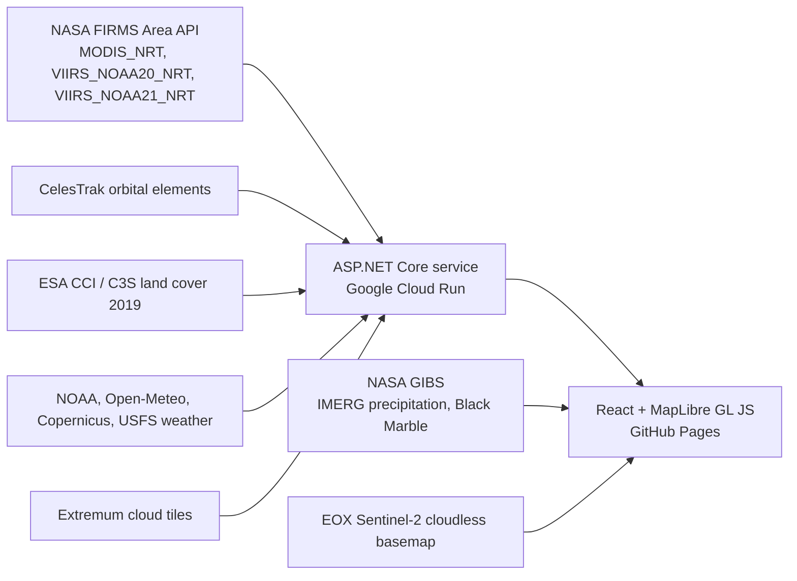

# Earth Fire Calendar: technical note

[Slides](demo-slides.md) · [Video script](demo-video.md) · [Project page text](project-description.md) · [Technical note](technical-note.md) · [Form fields](form-fields.md) · [Formal requirements](formal-requirements.md) · [Advice](advice.md)

**Challenge:** Harmonization of MODIS and VIIRS Hot Spots · **Team:** `[team name]` · **Version described:** commit `82f1a17`, 15 November 2026 · **App:** [avbelkin.github.io/nasa-space-apps-sg](https://avbelkin.github.io/nasa-space-apps-sg/#z=3&lat=1.3521&lng=103.8198&sensor=modis&proj=globe&orbits=0&clouds=0&lights=0&rain=0) · **Code:** [github.com/avbelkin/nasa-space-apps-sg](https://github.com/avbelkin/nasa-space-apps-sg)

This note answers the questions the demo and the project page leave open: what exactly is computed, from which data, how it was checked, and what is still a plan. Draft: replace the text in `[square brackets]`.

## 1. Summary and status

Earth Fire Calendar is a web app that compares MODIS and VIIRS active-fire detections from the last 24 hours of NASA FIRMS data and attaches to each detection the conditions under which it was observed. It is a tool for studying the difference between the sensors: it makes the gap visible and collects the per-detection evidence needed to model it.

| Part | Status |
|---|---|
| Live 24-hour FIRMS detections, sensor filter, counters | Working, live data |
| Colouring of detection groups by sensor | Working, live data |
| Pinned 24-hour timeline with satellite passes | Working; passes are an orbital estimate |
| Viewing-geometry enrichment | Working; an estimate from public orbital elements |
| Land-cover enrichment | Working; fixed 2019 map |
| Weather at acquisition | Working for pinned detections; coverage depends on the source |
| FIRMS archive since 2000 | Not built |
| Harmonized record, calibration, validation | Not built; design in [section 6](#6-from-enrichment-to-harmonization) |
| FRP prediction from weather and observation conditions | Not built; exploratory |
| Area and date selection, export | Not built |

The app shows no sample or synthetic values.

## 2. The problem in the data

One snapshot of the app's feed, fetched on 15 November 2026 at 08:36:16 UTC, window 14 November 08:36 – 15 November 08:36 UTC, whole world. The summary is saved in [`firms-snapshot-2026-11-15T0836Z.json`](../assets/firms-snapshot-2026-11-15T0836Z.json).

| | MODIS (Terra + Aqua) | VIIRS (NOAA-20 + NOAA-21) |
|---|---|---|
| Detections in 24 hours | 8,127 | 79,349 |
| By satellite | Terra 2,614 · Aqua 5,513 | NOAA-20 41,306 · NOAA-21 38,043 |
| Day / night | 5,893 / 2,234 | 58,198 / 21,151 |
| Median FRP per detection | 14.5 MW | 5.6 MW |

VIIRS reported 9.8 times more detections than MODIS, and its typical detection was weaker. Both follow from the pixel size: a 375 m pixel resolves smaller and cooler fires, and one MODIS pixel can cover several VIIRS detections. These are counts of hot pixels per satellite pass, not of fires; the ratio is for this day only and varies by region, season and time of day (see the [literature review](modis-viirs-harmonization-literature-review.md), §1–§3).

## 3. System overview



- **Interface** (`ui/`): TypeScript, React 19, Vite, MapLibre GL JS with custom WebGL2 layers. A static site, rebuilt by GitHub Actions on every push to `main` that touches `ui/`.
- **Service** (`backend/`): C#, .NET 10, ASP.NET Core minimal API in a container on Google Cloud Run (`asia-southeast1`). It holds the FIRMS key, caches upstream data in memory and does all enrichment. There is no database: every cache is rebuilt from public sources.
- The view state (position, sensor, layers) lives in the URL hash, so any view can be shared as a link.

## 4. Detections: ingestion and display

**Ingestion.** The service queries the FIRMS Area API (`api/area/csv`) for `MODIS_NRT`, `VIIRS_NOAA20_NRT` and `VIIRS_NOAA21_NRT`, parses the CSV, and keeps position, acquisition time, satellite, FRP, brightness temperature, confidence, `scan` and `track` pixel size and the day/night flag. A snapshot is cached for 20 minutes and cut to a rolling 24 hours ending now, not to UTC calendar days. If a refresh fails, the previous snapshot is served and marked as a cached fallback.

**Confidence.** MODIS reports confidence as 0–100; VIIRS reports `low`, `nominal` or `high`. For display only, the VIIRS classes are mapped to 25, 65 and 95. These are not probabilities and are not comparable between the sensors.

**Display.** Dot size follows FRP, brightness follows confidence, pulse strength follows the age of the detection. Below the full-detail zoom, nearby detections are merged into one mark; selecting a mark expands it to all detections it stands for.

**Sensor comparison.** The **All sensors / MODIS / VIIRS** control filters the detections, counters and satellite tracks. In **All sensors** the detections are shown together with no calibration and no removal of duplicates; the internal name of this mode is `harmonized`, but it is not a harmonized product. With **Color fire spots by sensor**, detections that are drawn close together on screen form a group, and the group is coloured by its content:

| Colour key | Rule |
|---|---|
| Both sensors | The group has at least one MODIS and one VIIRS detection |
| MODIS only (2+) | Two or more detections, all MODIS |
| VIIRS only (2+) | Two or more detections, all VIIRS |
| Single detection | One detection |

The grouping is by screen distance, so it changes with zoom. It is a visual aid for finding agreement and disagreement, not a footprint-and-time match between passes.

**Pinned timeline.** Selecting a detection or a group pins a 24 × 1 h chart: FRP bars by satellite, the local Sun elevation curve, and two kinds of marks computed from orbits rather than taken from FIRMS:

- **Pass, no fire** — the satellite's swath covered the place in that hour and FIRMS has no detection there. The cause can be no fire, cloud, a fire below the detection limit, or a gap in the data; the app cannot tell which.
- **Processing** — passes within a fixed delay before now (90 minutes for VIIRS, 120 minutes for MODIS) whose detections may not have been published yet. The delays are our assumptions, not FIRMS status.

## 5. Per-detection enrichment

Each enrichment is optional and deferred: the detections are served first, and a missing value stays `null` with no substitute.

### 5.1 Viewing geometry

FIRMS near-real-time records do not carry the view angle. The service estimates it:

1. Take the satellite's orbital elements from CelesTrak (cached for 12 hours; embedded fallback sets if CelesTrak is unreachable).
2. Propagate the orbit with a J2 secular model and sample it every 15 seconds from 1 minute before to 7 minutes after the FIRMS acquisition time, which has minute precision.
3. Take the closest approach across the track as the moment of observation and report the slant range, the off-nadir angle at the spacecraft and the view zenith and azimuth at the hotspot.
4. For that moment compute Sun and Moon elevation and azimuth, the Moon's illuminated fraction, and the glint angle: the angle between the mirror reflection of the light source and the direction to the satellite, as defined in the MODIS Collection 6 and VIIRS 375 m fire algorithms.

The orbit result is dropped if the elements are more than five days from the acquisition or the match to the swath is implausible. The estimate ignores terrain, refraction and the instruments' own per-pixel geolocation. The interface shows off-nadir angle, distance, Sun and Moon elevation and glint, and Moon illumination, in separate MODIS and VIIRS columns.

### 5.2 Land cover

The service samples the Copernicus C3S land cover map v2.1.1 for 2019, the continuation of the ESA CCI Land Cover series: 300 m native grid, 1.2 km overview for whole-world requests, the same class codes in both. The footprint of a detection is approximated by a circle with the same area as its `scan` × `track` pixel; if those fields are missing, by the nominal pixel radius. The result is the dominant class, the share of each class in the footprint and the fraction of the footprint with classified data.

The map is a fixed 2019 reference, not the cover on the day of the fire. On the 1.2 km overview a whole VIIRS footprint can fall into one cell.

### 5.3 Weather at acquisition

For pinned detections (up to 16 per request) the service samples each source at the detection's acquisition time and returns, for every value, the source, model run, valid time or interval, unit and sampled grid point. For NOAA GFS a model run is used only if its file was published before the acquisition; the other forecast sources report validity but not publication time.

| Source | Fields | Coverage and time matching |
|---|---|---|
| NOAA GFS | Temperature, dew point, humidity, visibility, wind and gusts, irradiance, cloud cover and layers, column water, precipitation type, snow depth and cover, soil water by depth, cloud liquid and ice water at pressure levels | Global; run and valid hour chosen explicitly; bilinear sampling, nearest cell for flags |
| NOAA GOES-R ABI and GLM | 10.3 µm brightness temperature, cloud class, cloud fraction over the footprint, optical depth, cloud-top height and phase, smoke flag, lightning flashes within 50 km | GOES East and West coverage; completed scans matched to acquisition, scan times kept |
| NOAA nowCOAST | Radar reflectivity; visible and infrared counts from the global satellite mosaic | Radar regional, within 8 minutes; mosaic hourly, within 1 hour |
| Open-Meteo | Weather codes, 3- and 24-hour precipitation totals, aerosol optical depth, particulates, CO | Global, hourly; totals need every hour of the window |
| Copernicus GWIS | Fire Weather Index, danger class, Fine Fuel Moisture Code, Drought Code, modelled lightning density | Global, daily; date-level precision |
| Copernicus GDO | Soil-moisture anomaly against 1995–2023 and its class | 10-day periods; the latest period completed at acquisition |
| NOAA CPC | Weekly soil-moisture departures at 0–10, 10–40, 40–100 cm | North America; the latest completed week |
| US Forest Service WFAS | 10-, 100- and 1,000-hour dead-fuel moisture | Contiguous United States; daily, no verified hour |

The interface shows 23 of these fields in the **Weather at acquisition** table and hides the rows that no source could fill. Model values are not observations, and daily and weekly products describe the period, not the minute of the pass. Which fields are worth testing first, and why, is in [`doc/live-hotspot-weather-enrichment.md`](../../doc/live-hotspot-weather-enrichment.md).

## 6. From enrichment to harmonization

Nothing in this section is implemented.

**What the literature already does.** Existing methods convert between the two pixel systems by geometry and statistics: projecting VIIRS detections into the MODIS pixel footprint, view-angle corrections of FRP, quantile mapping, observation operators based on pixel area, aggregation onto a common grid. Land cover is used as well, including jointly with scan position in GFED5NRT. The [literature review](modis-viirs-harmonization-literature-review.md) (82 sources) covers this in §2–§5.

**The hypothesis we want to test** (review, §6): the residual MODIS–VIIRS difference in detections and FRP, especially by day and at oblique view angles, depends on the interaction of detailed land-cover class and viewing geometry at the level of individual detections. The test is whether class-specific angular response functions improve on existing corrections under comparable observing conditions. One published result limits it: for matched fire clusters and the 750 m VIIRS product, the MODIS/VIIRS FRP ratio did not depend on view angle in any of five ecosystems.

**A second, exploratory question.** Can a detection's FRP be predicted from weather and observation conditions? The weather fields in section 5.3 are collected with this in mind; no model exists yet.

**Why the prototype collects these fields.** The test needs, for each detection, the actual pixel size, the view angle, the illumination, the land-cover composition of the footprint and the state of the atmosphere along the view path. Sections 5.1–5.3 produce these for the live feed.

**Planned pipeline.**

1. FIRMS archive since 2000 for MODIS and since 2012 for VIIRS.
2. A daily grid per satellite, day and night kept separate, with repeated passes counted once.
3. Pairing of near-simultaneous MODIS and VIIRS observations by footprint overlap and time difference, during the years when both flew.
4. Response functions from the paired data: first by view angle and pixel area, then with land-cover class added.
5. One reference scale for the whole record.
6. Export. A seasonal calendar built on the record is a possible follow-up.

**How we will test it.**

- Hide one sensor during the overlap years and reconstruct it from the other.
- Hold out whole years and a contrasting region.
- Compare with simple baselines: no adjustment, and one global scale factor.
- `[Draft pass criteria, to be fixed before the archive is processed: lower error than both baselines on the held-out years and region; no step at the start of VIIRS larger than the year-to-year variation before it; the land-cover term kept only if it lowers the held-out error.]`

**If calibration fails,** the app will show each sensor separately and label the combined view experimental.

The data constraints behind this plan and the design decisions for the measure, the reference scale and the calendar are in the [design notes](harmonization-design-notes.md).

## 7. Known limitations

- **Detections are not fires.** A detection is a thermal anomaly in one pixel on one pass. Gas flares, volcanoes and industrial sources are in the feed; the live FIRMS records carry no type flag, and the app does not filter them.
- **No evidence of absence.** The live feed has only positive detections. A place without a point may be burning under cloud, below the detection limit, or outside the usable part of a swath. Estimating missed fires needs the swath-level products, which the prototype does not read.
- **Time of day.** The four satellites pass at different local times, and Terra and Aqua have drifted from their original orbits. A difference in counts mixes sensor sensitivity with the daily cycle of fire.
- **Estimated geometry.** Section 5.1 is an approximation from two-line elements with a simplified propagator. It is suitable for comparing nadir with swath-edge observations, not for per-pixel geolocation.
- **FRP is not additive across passes,** and several 375 m VIIRS detections can share one 750 m FRP retrieval, so individual VIIRS detections are not independent FRP measurements.
- **Near-real-time data.** NRT records are replaced later by standard-quality products; the numbers in this note will not match the archive exactly.
- **One instance, in memory.** Enrichment caches are per service instance and are lost on restart; a newly started instance returns detections first and enrichment later.

## 8. Verification

- **Automated tests:** 41 backend test cases (xUnit) and 99 interface test cases (Node test runner). They cover FIRMS CSV parsing and confidence normalization, the orbit, swath and geometry calculations, land-cover footprint sampling including tile edges and the antimeridian, each weather sampler against recorded fixtures, the enriched-feed endpoint, and the interface's grouping, timeline and URL-state logic. `[Run both suites on the submitted commit and record the result here.]`
- **Build:** GitHub Actions builds the service in Release mode and the interface on every push; both deployments of `82f1a17` completed successfully on 15 November 2026 at 08:34 UTC.
- **Live check:** on 15 November 2026 at 08:36 UTC the public app returned HTTP 200, the service reported healthy, and the feed returned the snapshot in section 2.
- **Not verified:** the estimated view angles against the instruments' own geolocation products; the weather samples against station observations; any harmonization result, because none exists yet.

## 9. Reproducing the numbers

The service is public and needs no key:

```text
GET  https://earth-fire-calendar-api-354cntvldq-as.a.run.app/api/fires/spots?hours=24&sensor=harmonized
GET  …/api/fires/spots?hours=24&sensor=modis&bbox=95,-11,141,6&enrichGeometry=true
GET  …/api/fires/spots.geojson?hours=24&sensor=viirs
POST …/api/fires/spots/geometry   {"spots":[{"lng":…,"lat":…,"timestampMs":…,"satellite":"NOAA-20"}]}
POST …/api/fires/spots/weather    same body, up to 16 detections
GET  …/api/satellites/orbits
```

The response of the first request carries `count`, `modisCount`, `viirsCount`, the window bounds and the per-dataset counts used in section 2. The feed is a rolling window, so a later request returns different numbers. To run the app locally, see the [README](../../README.md); the endpoint reference is in [`doc/architecture-and-harmonization.md`](../../doc/architecture-and-harmonization.md).

## 10. Data, licences and AI use

All data sources, software components and their licences are listed in the [project page text, field 8](project-description.md#8-space-agency-partner-data-and-other-references); NASA data and its role in [field 7](project-description.md#7-nasa-data).

AI coding assistants (`[Anthropic Claude Code, OpenAI Codex — confirm the list]`) were used to write and review code and to draft documentation, including this note. The app makes no AI calls and shows no AI-generated content. The idea, the hypothesis and the decisions on what to build are the team's.

Independent project built for the 2026 NASA Space Apps Challenge. Not affiliated with or endorsed by NASA.
